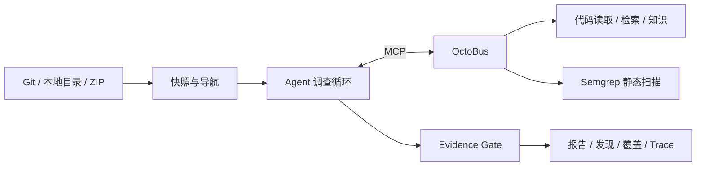

# CodeAudit Agent

**基于大模型、MCP 工具调用与证据校验的代码安全审计个人作品。**

输入 Git 仓库、本地目录或 ZIP，Agent 自主制定调查计划，读取代码、追踪跨文件数据流、检查保护条件，并输出带源码引用的发现、覆盖范围和修复建议。适合研究 Agent 审计流程、复现安全分析案例，以及辅助人工代码审查。

## 作品设计

- **自主调查**：模型围绕攻击面建立假设、选择工具、补充证据和形成判断。
- **证据校验**：Evidence Gate 核对文件哈希、行号、字面引用及实际读取记录，拒绝或降级证据不充分的结论。
- **能力分工**：agent-compose 管理运行沙箱，OctoBus 通过 MCP 路由代码检索、知识查询和 Semgrep 静态扫描。
- **可追溯结果**：保留计划、工具调用、发现、未读文件与未知条件，便于人工复核。



## 快速开始

需要 Docker Engine/Desktop、Docker Compose v2（支持 `volume.subpath`）、Python 3.9+、Git，以及支持 tools/function calling 的 OpenAI-compatible Chat Completions 模型。建议准备 4 CPU、8 GiB 内存和 15 GiB Docker 可用空间。首次构建需访问 GHCR、Debian、PyPI 和 npm。

```bash
git clone https://github.com/m13756445700-lgtm/codeaudit-agent.git
cd codeaudit-agent
cp .env.example .env
# 编辑 .env，填写 LLM_API_ENDPOINT、LLM_MODEL、LLM_API_KEY
./scripts/start.sh
./scripts/healthcheck.sh
./scripts/demo.sh c
```

启动脚本构建镜像、创建独立数据卷、生成本地鉴权配置并注册 MCP 能力。真实审计需要模型 API 配额，调用会产生相应费用。环境配置和生成的运行结果默认不提交 Git。

审计其他公开仓库：

```bash
./scripts/demo.sh https://github.com/OWNER/REPO.git
```

审计本地目录（先完成启动）：

```bash
docker compose --env-file .env --env-file .runtime.env run --rm \
  -v "$PWD/benchmark:/input:ro" codeaudit-agent /input/cross-file-flow --keep-source
```

ZIP 也需显式只读挂载后使用容器内路径。完整部署、端口、停止与恢复说明见 [部署指南](docs/DEPLOYMENT.md)。

## 示例与输出

| 示例 | 命令 | 观察重点 |
|---|---|---|
| SQL 拼接 | `./scripts/demo.sh a` | 输入到 SQL 执行点的证据链 |
| 固定映射 | `./scripts/demo.sh b` | 保护条件与误报排查 |
| 跨文件命令链 | `./scripts/demo.sh c` | 多文件数据传播与调用关系 |
| 公共仓库 | `./scripts/demo.sh d` | 真实仓库调查与覆盖边界 |

每次审计生成独立目录，主要结果包括：

| 文件 | 用途 |
|---|---|
| `report.md` | 阅读发现、风险和建议 |
| `findings.json` | 检查判断、引用、反证及未知条件 |
| `coverage.json` | 核对已读与未读范围 |
| `audit_plan.json` | 查看调查计划 |
| `tool_calls.jsonl` | 追溯工具调用 |

`COMPLETE` 仅表示本次计划范围内的有界调查完成；延期产生 `PARTIAL`，执行失败或预算耗尽产生 `INCOMPLETE`。这些状态均不能解释为整个仓库安全。导出和复核步骤见 [使用示例](docs/DEMO.md)。

## 测试与复现

无需模型密钥的离线检查：

```bash
python3 -m venv .venv
source .venv/bin/activate
pip install -r requirements-dev.txt
make test
python scripts/validate_schemas.py
```

完整启动后，可按需执行：

```bash
make docker-test       # 容器内离线回归
make integration-test  # 真实模型与 MCP 集成，会调用模型
make ablation-test     # 同一快照的静态分析与 Agent 对照，会调用模型
make benchmark        # 固定 20 个样例，会调用模型
```

`benchmark/` 提供固定标注样例，`evaluation/` 保留业务场景及知识对照输入。样例用于验证具体行为，不代表真实项目上的普遍准确率。模型结果存在随机性，应结合原始证据复核。

## 项目结构

```text
agent/               审计引擎、输入处理、证据校验和静态分析
benchmark/           固定安全分析样例与标注
evaluation/          可复现的评估输入
knowledge/           安全判断知识
rules/               Semgrep 规则
schemas/             结构化结果与工具契约
octobus/repo-tools/  MCP 能力桥接
scripts/             启动、演示和评估工具
tests/               单元、契约与回归测试
docs/                架构、部署、使用与安全说明
```

## 使用边界

- 面向可信单操作者，agent-compose 使用 Docker socket；daemon 和 MCP 不应对公网开放。
- 目标代码作为数据读取，不执行其构建、依赖安装或漏洞利用。仅审计你拥有或获授权的代码。
- 被选中的源码片段会发送到配置的模型服务，使用前需确认代码保密要求。
- Python 导航结合 AST，其他语言主要使用词法线索；不等于完整调用图或全面语言支持。
- 模型可能误判或漏判，Evidence Gate 校验引用完整性，不能证明漏洞语义必然正确。
- 默认预算为 48 轮、100 次工具调用、1,200 秒；可通过 CLI 参数调整，增加预算不保证完整覆盖。
- 报告、Trace、快照可能包含私有源码，应按敏感数据保存，不应直接公开上传。

进一步阅读：[架构设计](docs/ARCHITECTURE.md) · [部署指南](docs/DEPLOYMENT.md) · [使用示例](docs/DEMO.md) · [安全边界](docs/SECURITY.md) · [评估说明](evaluation/README.md)。

## 许可证

本项目采用 [MIT 许可证](LICENSE)。第三方组件及依赖遵循各自的许可证。建议先完成本地离线测试，再配置模型运行示例 C，检查报告与证据后用于自己的审计场景。
